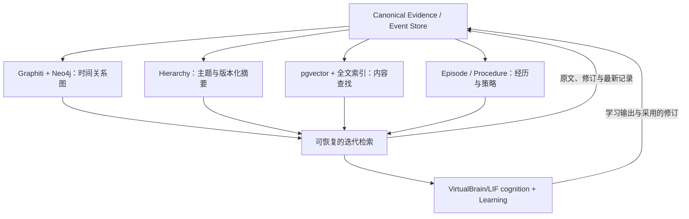

# 长期 Agent Memory 改造确定方案 v1.0

日期：2026-10-04（北京时间）  
状态：架构与主路线确定；尚未实施、性能未经实测。  
适用对象：Ferro，以及持续存在、持续学习、持续行动的其他 Agent。

## 1. 已作出的决定

采用一个自己控制的记录底座，从中构建多个可重建的记忆视图。Memory 成为 Agent Runtime 下的通用 capability；Ferro 保留 identity、goals、mission、domain policy。VirtualBrain/LIF 保持独立的认知和内部驱动职责。

**固定主方案：Canonical Store + Graphiti/Neo4j + 独立主题层次 + pgvector/全文检索 + 完整经历与策略记录 + 可恢复的迭代检索。**

固定备选为 Hindsight。仅在主方案未通过明确的适配或资源验收时，更换派生 provider；不同时维护两套正式 Memory 引擎。

| 部分 | 固定实现选择 | 权威边界 |
|---|---|---|
| Canonical records | 新的通用部署采用 PostgreSQL；现有可靠底座先保留并审查 | 原始记录、修订及采用决策的唯一权威 |
| 原文与媒体 | 当前文件归档可继续使用；按内容哈希定位，后续可换对象存储 | 保存已获取的来源快照，URL 只是附加信息 |
| Temporal Graph | graphiti-core + Neo4j Community | 唯一正式关系图，属于可重建投影 |
| 主题 hierarchy | SQL 保存主题节点、成员关系、摘要版本；独立后台流水线更新 | 导航和摘要，不裁决事实 |
| 文档局部层次 | LlamaIndex 的分块、父子节点和递归读取组件 | 辅助读原文，不承担完整领域树 |
| 原文向量 | pgvector | 原文和摘要的语义召回 |
| Lexical | PostgreSQL 全文检索，显式配置中文分词 | 关键词查找，不宣称等同于 BM25 |
| Episode | Canonical 中保存完整经历及有序事件引用 | 保留过程，而非只保留摘要 |
| Procedure | Canonical 中保存策略版本、尝试与结果；SQL 派生统计 | 学习产生的行为经验 |
| Retrieval | Runtime 的可恢复流程 + 认知层的下一步决策 | 按任务取证、判断缺口、停止 |
| 模型调用 | 统一可替换模型接口，LLM 和 embedding 分别配置 | 支持本地或非 OpenAI provider，无 OpenAI API 强依赖 |

这里的 PostgreSQL 是目标部署选择，不是要求先迁移当前全部数据。第 0 阶段核对现有 canonical 实现；如果它已满足契约和恢复要求，当前部署继续使用它。新存储和旧存储不并行成为两个权威。现有 BM25 若已可用，迁移期间继续作为 lexical provider；切换后只保留一个正式 lexical 写入路径。

不默认部署 Microsoft GraphRAG 全套、不引入 Letta Runtime、不同时挂 Mem0/Cognee/Supermemory 形成同步链。GraphRAG 的社区报告仅作为后续有明确需求的扩展。

## 2. 固定评价标准

按以下标准评估，不因后续追问或框架宣传改变标准：

1. 原始 evidence/event/receipt 独立保存；框架损坏、停用和升级都不改变这些记录。
2. 时间语义正确：发生时间、记录时间、事实有效期、采用修订时间可区分。
3. 新记录和修订能增量传播；没有每次全量读取历史的隐含路径。
4. 所有重要结论、关系、摘要和策略都有依据及生成版本。
5. Graph、Hierarchy、Vector/Lexical、Episode、Procedure 有独立读取入口。
6. 检索按任务有界运行，预算耗尽与证据充分是不同结果。
7. 中断可恢复，重复处理不生成重复行动或统计。
8. 多 Agent 私有范围一致，共享知识明确指定。
9. 核心 provider 可自托管、可退出，不依赖 OpenAI API。
10. 质量、更新成本、资源峰值和维护负担通过同一套实测评估。

架构决定已确定；Graphiti 是实施首选；RAM、吞吐、抽取质量和替换收益尚未证明。本文不承诺该完整组合能够在当前 VM09 与浏览器共同运行而无需调整。

## 3. 总体架构



Graph 和 Hierarchy 共享证据身份、来源和修订记录，不互相成为唯一来源。主题 hierarchy 可直接从来源内容与分类派生；社区 hierarchy 可以利用已存在的图结构，但必须保留到 canonical 的溯源。

Episode、Semantic、Procedure 是记忆内容类型；Graph、Hierarchy、Vector/Lexical 是组织和查找方式。不为每个类型部署一套数据库。

## 4. 模块职责与进程边界

| 模块 | 拥有的职责 | 不属于它的职责 |
|---|---|---|
| Runtime | 任务调度、执行状态、恢复、capability 生命周期、授权 | 长历史常驻内存、知识抽取、事实推断 |
| Memory capability | 归档、记忆修订接口、索引与证据读取、检索结果规范化 | owner policy、外部动作执行、决定 Agent 追求什么 |
| Learning capability | 预测与结果比较、形成知识或策略修订、更新经验统计 | 成为另一个事实数据库 |
| VirtualBrain/LIF | 注意力、驱动、理解、检索下一步与策略选择 | 直接依赖 Graphiti/Neo4j 内部对象 |
| Research | 查询新的外部知识，返回来源与证据 | 静默改写已有知识 |
| Browser/Channels | 世界观测、执行与实际 receipt | 把内部规划当作完成 |
| Ferro | identity、goals、mission、domain policy | 私有存储、图算法、浏览器实现、检索引擎 |

单主机起步部署：Runtime supervisor、Memory 查询服务、一个 Memory 后台索引 worker、共享模型服务。worker 使用数据库任务表，不新增 Kafka 或 Redis 队列。查询和索引的重任务在独立进程执行，避免模型加载、图抽取、摘要影响 Runtime 主进程。

“独立”要求可分别恢复、有明确接口、有资源计量；不要求每个函数都成为微服务。主进程负责启动、监测和协调；任务业务留在对应 capability。

## 5. Canonical 数据契约

### 5.1 最小记录类型

| 类型 | 保存内容 |
|---|---|
| Evidence | 原文快照、来源标识、获取时间、内容哈希、片段定位 |
| Event | observation/action/receipt/outcome 等实际记录，发生时间与记录时间 |
| Episode | 有序 event IDs、任务和参与对象、完整过程；摘要另存为派生物 |
| Prediction | 预测提出时的条件、预期结果、评估时间窗口、引用证据 |
| Learning result | 对结果的解释、支持与反例、提出的知识或策略修订 |
| Memory revision | claim 身份、类型、正文、状态、时间、依据、替代/争议关系 |
| Adoption decision | 哪个修订被采用、何时采用、为什么、依据何在 |
| Procedure revision | 适用条件、动作/策略、版本、结果指标及学习偏好 |
| Derivation artifact | 已影响行为的抽取/总结/解释输出、生成模型和流水线版本 |

原始记录不可因 ACTIVE/DISPUTED/SUPERSEDED、TTL 或索引清理而删除。来源说法、Agent 假设、预测、世界观测、学习结论必须带不同类型。

Canonical 证明“来源说了什么、Agent 做了什么、系统采用过什么”；不会自动证明来源内容正确。ACTIVE 表示当前采用版本，不等于已证实。因果边区分来源主张、Agent 假设、实验支持，不把共现当因果。

### 5.2 公共字段

核心记录携带：稳定 canonical ID、schema version、tenant/owner scope、agent ID、private/shared scope、occurred_at、recorded_at、来源/引用、内容或 blob 引用、生成者与生成版本。

适用的 claim/revision 另外携带 valid_from/valid_to（未知可为空）、修订序号、采用状态及依据。时间推断和显式来源时间区分标记。发生在过去但现在才收到的记录，不自动覆盖较新的世界状态。

预测和内部学习输出不能伪装成观察结果。学习不能修改 owner 权限或 mission 授权。

### 5.3 两种历史查询

检索契约分别支持：

- valid_at：要查询哪个世界时间的事实。
- known_at：只允许使用在某个记录/采用时间之前可知的证据和修订。

例如“9 月 1 日发生了什么”与“截至 9 月 1 日 Ferro 知道什么”是两个问题。两者结合才可复盘预测是否使用了未来信息。Graphiti 的时间字段通过 adapter 映射，不能仅改字段名便声称完整支持这两种查询。

## 6. 唯一事实修订与 Graphiti 适配

唯一权威是 canonical 中的修订与采用记录。Neo4j 中的实体、边、时间和状态是投影，不允许脱离 canonical 独立接受业务事实修改。

统一流程：

1. 原始 evidence/event 先保存。
2. 抽取或冲突识别产生候选结果，保留生成版本和依据。
3. Memory 的统一采用规则记录修订决策；可自动处理，不要求人工逐条确认。
4. 被采用的修订发布到关系图、摘要与内容索引。
5. 检索返回关系候选时，根据 canonical 的时间、状态与范围解释结果。

Graphiti 的自动 invalidation 不直接等于 Agent 已接受该事实变化。Graphiti 可能先在内部修改派生图；该变化仍须被记录并通过统一采用流程，在 canonical 尚未提交前不得作为已采用知识供业务读取。此边界是必须实现和验收的适配，不能假设默认 add_episode 已完成。

适配须通过当前稳定 SDK/明确的写入接口完成。若需要长期深度 fork 才能正确控制采用状态、provenance 和重建，则触发备选，不额外再造一个 Graphiti。

稳定 canonical 实体/claim 身份和 provider 内部 UUID 保存映射。Agent 不保存 Neo4j node ID、Graphiti UUID 或 provider 专属返回对象。

重建使用 evidence 加已采用的结构化派生记录。重建可以更换索引组织，但不能重新调用模型后静默替换历史采用决策。重新理解旧来源应产生新的 derivation/revision，而不是冒充同一次重建。

只维护一套正式关系图。迁移验证时旧实现只读；新实现通过验收后切换写入与读取，删除旧关系扩展/抽取路径。它不是永久双写、双裁决架构。

## 7. 独立层次索引

主题导航采用 domain/topic/subtopic 结构，允许证据属于多个节点，不强迫所有知识只有一个父主题。社区层次独立于主题层次，默认不启用。

每个节点保存：节点 ID、类型、父子/成员引用、关联 canonical IDs、摘要正文、源记录版本、生成版本、更新时间和待更新状态。

新增记录放入相关主题；修订、争议和失效标记相关节点及祖先待更新。摘要生成读取受影响成员，保留关键变化、争议与证据链接。不是仅把旧摘要无限再压缩；达到预定合并次数或发现争议时回读底层来源。

LlamaIndex 辅助处理长文档的章节/父子分块及递归读取。完整领域树的分类、成员关联和修订传播由 Memory 管理，避免把 HierarchicalNodeParser 误当通用知识层次系统。

Hierarchy 不是唯一召回入口：精确 ID、关键词、语义查找可直接命中底层证据，以免摘要遗漏导致永久漏召回。

可选 GraphRAG 扩展：只有跨 corpus 全局问答实测需要社区报告时，导出同一正式关系图，采用 BYOG 工作流生成社区与报告。跳过实体/关系重新抽取。导出快照和社区报告都是可删除的派生物。

## 8. Episode 与 Procedure

Episode 保留任务开始时的背景、当时可知的证据、决策/行动、失败、receipt 和后续 outcome，通过有序引用读取。图中可包含 episode 链接，但完整过程保存在 canonical。

Procedure 保存 condition → strategy/action version → unique attempts → outcomes → learned preference。最小统计包括成功、失败、pending/unknown、成本、耗时、时间窗口和样本数。pending 不进入失败分母；重复 outcome 不重复计数；外部环境变化可使旧策略进入待复验状态。

Learning 形成候选规则，Memory 保存，VirtualBrain/LIF 在适用条件下采用。保留原来的策略版本以支持历史复盘。过程只使用已有统计工具，不为了这一能力额外引入完整 RL 框架。

“发帖前需要读原文”这样的经验要有失败/成功证据；“发布后净增粉丝”要记录窗口和观测。净增不能直接证明某条帖子的因果效果，也不能将模型的信心当统计准确率。

学习验收必须表现为：新 outcome 被采用后，相同或相近条件下，下一次证据选择/行动策略与此前不同，并能指出影响它的修订。仅新增反思文本不算学会。

## 9. Provider 无关接口与检索结果

业务接口固定为：

```text
append_event(record) -> canonical_id
archive_evidence(record) -> evidence_id
read_evidence(id, span) -> content + provenance
search(query, scope, valid_at, known_at, view, budget) -> candidates
read_episode(id, range) -> ordered records
lookup_procedure(condition, scope, time) -> strategies + statistics
propose_revision(revision) -> proposal_id
record_adoption(decision) -> revision_id
```

索引 worker 的 rebuild/update/progress 接口不直接作为 Agent 的业务工具。

候选结果统一返回：canonical_id、kind、摘录或摘要、source spans、validity/status、scope、retrieval view、provider/version、indexed-through checkpoint 和排名依据。摘要与关系候选不能装成原始证据。

Scope 在查找和读取前生效，不只是结果末尾过滤。共享记录带明确范围及原作者。实体匹配、矛盾判断和主题摘要不能跨私有范围融合。Graphiti group_id 和 provider 的 namespace 只是实现手段，通用 scope 契约由 Memory 保证。

分数只用于候选排序，不作为真相概率。Graph 内部的实体/边向量与 pgvector 的原文/摘要向量有不同对象边界；不对同一批原文建立两套正式向量索引。

## 10. 可恢复的多轮检索

认知层确定本次信息需求和下一步查询；Runtime 保存流程状态及预算；Memory 执行读取。Memory 不复制一套人格、目标或独立认知核心。

检索状态包含 task ID、信息需求、已查范围、候选 canonical IDs、已读取片段、未解决矛盾、剩余预算和下一步。

流程：明确问题 → 选择入口 → 查候选 → 按需读原文/经历 → 判断缺口 → 补查或 Research → 充分则返回。

入口不固定顺序。receipt ID 直接读记录；研究一个领域先看 hierarchy；关系变化查 Graph；做策略选择读取 Procedure 与反例 Episode。关键词/向量可以与其他入口组合。

本方案的初始检索配置（工程默认值，不是质量实测结论）：

- 最多 4 个检索决策轮次；每轮可执行多个有明确目的的查询。
- 最终 memory context 默认上限 6,000 tokens；这是记忆部分，不是整个模型上下文。
- 原文按片段读取；候选只先返回短摘录、时间与引用。
- 预算在任务开始时明确给出；特殊研究任务可显式申请更大预算，不进行隐藏 clamp。
- exact lookup 可在一轮完成，不强行加入模型规划。

终止结果区分 EVIDENCE_SUFFICIENT、EVIDENCE_INCOMPLETE、BUDGET_EXHAUSTED、PROVIDER_ERROR。不得把截断、失效索引或调用错误伪装成“没有相关记忆”。证据不足可作为任务的明确输出，不强行编造答案。

外部新知识由 Research capability 获取，归档后进入本次证据集合。记忆检索不在内部静默无限上网。

最终 context 包含本次需要的证据、必要摘要、适用策略、矛盾/缺口和可展开引用，不携带全部历史、全图或全量学习日志。短引用标签映射到 canonical ID，由程序管理，不要求模型反复抄写长 ID。

## 11. 增量更新与中断恢复

小型事件/receipt 可直接保存在数据库事务中。大原文先完成归档，再在事务中写入引用与待索引任务。数据库与文件存储不能假装具有跨存储原子事务；没有数据库引用的归档文件后续可整理，已经提交的引用必须指向完整内容。

索引任务具有稳定身份、输入版本、处理状态和 checkpoint。每个 provider 记录处理到哪个事件。处理失败显式记录；重启后从未完成任务继续，不重跑已确认的外部动作。

各索引可有短暂滞后，结果必须暴露 indexed-through。当前任务必需的最新记录可以按 ID 或小范围直接读取 canonical，不因此装载全部历史。需要最新状态却索引落后时，要报告或等待对应任务，不能假装覆盖。

索引完成确认不能先于实际写入；任务可重复执行但不重复计数。关系索引、层次索引或模型失败不会使已经保存的 receipt 消失。

数据备份覆盖 canonical 数据库与原文归档；仅备份 Neo4j 或向量索引不算完整恢复。索引可重建，但重建时间和模型成本也要测量。

## 12. 资源策略

1. 不把数据库全量内容、全部历史或全图载入 Runtime 常驻内存。
2. 默认一个索引 worker，抽取并发起步为 1；增加并发必须有实际吞吐需求与资源余量。
3. 结构化 receipt、时间戳、结果记录直接投影，避免重复用 LLM 推断已知字段。
4. 有价值的原文批量抽取；心跳等运行信号保持为运行记录，不强行进入知识图。
5. 模型由共享服务提供，不为每个 Agent/worker 各加载一份。允许独立机器上的自托管端点；不把“本地可用”等同于“当前小主机免费且轻量”。
6. pgvector 先建立检索基线；是否启用 HNSW、选择何种向量尺寸，用实际规模测量决定。向量最近邻准确不等于语义召回正确。
7. Neo4j heap/page cache、PostgreSQL 工作内存和查询并发显式配置。测总 RSS、CPU、磁盘与共享模型成本，不只测单个进程。
8. 输入、token 和时间预算明确记录；失败暴露，不增加静默吞错和自动绕过主路线的 fallback。

资源预算在第 0 阶段根据真实主机总量、浏览器峰值和现有服务占用填写。缺乏这份测量时不得宣称可以部署到 VM09。运行多年通过持续增量、磁盘归档和按任务读取实现，不要求多年数据全部驻留 RAM。

## 13. 按顺序实施

| 阶段 | 要做的工作 | 阶段交付 | 退出条件 |
|---|---|---|---|
| 0：现状审查 | 核对仓库、存储、实际调用链、部署版本、资源；建立基线 | 当前模块映射、数据契约映射、依赖锁定及资源预算 | 已知道保留什么、替换什么，且有可比较基线 |
| 1：通用 capability | 移出 Ferro 的存储/检索/摘要逻辑；统一 ID、scope、事件与修订接口；索引独立 worker | Memory capability 和兼容现有底座的 adapter | 已保存的记录不变；服务中断不丢 receipt |
| 2：Graphiti 替换 | 接入 graphiti-core/Neo4j；映射 provenance、时间和采用修订；真实数据回放 | 唯一新关系 provider、适配结果和成本数据 | 时间/矛盾/范围/重建验收通过，无必须长期维护的深度 fork |
| 3：Hierarchy/Hybrid | 补主题关联、摘要版本与修订传播；LlamaIndex 局部分块；原文 vector/lexical 统一 | 独立可重建层次和内容检索 | 跨主题问题、原文定位与更新传播通过 |
| 4：完整 retrieval | 接通所有视图、原文读取、Research 和停止条件；保存多轮 checkpoint | 生产可用的迭代检索入口 | 满足本次任务且上下文有界；错误/缺口可解释 |
| 5：Learning/Procedure | outcome 绑定、策略版本与统计、后续行为采用 | 至少一条可追溯学习与行为改变证据链 | 不仅记下反思，而是后续行为因结果改变 |
| 6：生产闭环/清理 | 真实触发、草稿、发布 receipt、世界观测、结果回流；重启与重建；删除旧路径 | 完整验收记录、单一正式写入路径、旧实现删除清单 | 全部验收通过后切换；不长期双写双裁决 |

完整 retrieval 在第 4 阶段统一接入。此前已有检索可继续服务，但不宣布它等于新方案完成。数据库需要迁移时：先完整备份/转换/比对，再切换唯一 writer，旧存储只读保留至恢复演练通过，随后退出正式运行。

不预设未审查代码的文件名或承诺工期。实施中只能调整 adapter 和预算等实现细节；改变主框架、权威边界或数据契约必须记录为明确的新架构决定，并给出触发证据，不能静默改说法。

## 14. 验收与 benchmark

所有 provider 比较使用同一份 canonical 数据、同一套问题、同一生成/embedding 模型及同一 context 预算。保留当前实现和只用混合内容检索的基线，确认复杂索引确实改善任务。

| 验收 | 方法 | 必须成立的结果 |
|---|---|---|
| 数据完整 | 比较迁移前后 ID、内容哈希、事件数与引用 | 已保存 evidence/event/receipt 不丢、不被静默改写 |
| 双时间 | 构造过去发生、后来收到，以及事后修正的记录 | 世界时间与当时所知分别可查询，无未来信息泄漏 |
| 矛盾/采用 | 同对象多来源冲突、被采用修订、仍有争议 | 不简单采用最新文本；采用决策可回溯 |
| 原文召回 | 从真实任务人工标注应读证据及片段 | 报告 evidence recall、遗漏类型、上下文 token 和答案支持率 |
| 跨主题 | 问题同时涉及多个领域，证据不在单一主题 | 不因单一路径的摘要漏召回 |
| 摘要更新 | 新增、修改、失效分别重跑 | 相关摘要更新；引用和版本正确 |
| Episode | 根据经历恢复当时输入、行动、失败、receipt 与 outcome | 顺序和当时上下文完整 |
| Procedure | 新结果提交后，在相近条件下再作选择 | 行为变化能指向该学习修订；统计不重复计数 |
| 恢复 | 在归档、图写入、摘要和索引确认之间分别中断 | 已提交记录保留；索引续跑；外部动作不盲目重复 |
| Provider 替换 | 删除派生索引并从 canonical 重建，运行相同查询 | 历史采用记录不变，证据与范围仍可解释 |
| Agent 范围 | 不同私有 Agent 记录及显式共享记录 | 私有数据不串；共享记录只在授权范围使用 |
| 资源 | 实际数据量和增长规模，采集空闲/更新/检索/重建峰值 | 满足第 0 阶段填写的 RAM/CPU/延迟预算 |

召回率、答案质量和延迟需报告原始数据、模型版本、任务分布和重复运行结果；不以一个厂商分数代替。硬门槛是数据完整、时间/范围正确及恢复成立。质量门槛在第 0 阶段根据基线固定，不能跑完后再调整到恰好过关。

Ferro 的最终业务验收：真实任务触发 → 记忆检索/原文读取 → 学习结果及必要的记忆修订 → 有依据的发帖上下文 → ChatGPT 草稿 → 实际发布及 POSTED receipt → 外部结果观测 → 下一次行为采用结果。

人工为了测试发送一个请求不等于长期自主闭环已完成。24h 等延迟结果未到时保留 pending，并说明当前完成到哪一步。

## 15. 备选切换条件

固定备选：同一 Canonical contract + Hindsight provider + 独立主题 hierarchy + 原有 Procedure/检索控制。

仅当以下任一问题被实测确认且在既定预算内无法解决时切换：

- Graphiti 无法通过可维护的接口实现采用修订、时间映射和可追溯重建，需要深度 fork。
- Graphiti/Neo4j 加共享模型的总资源超过第 0 阶段预算，合理配置仍不成立。
- 在相同模型/数据/预算下，时间关系或关键证据检索持续未达到固定验收标准。

Hindsight 主要使用 PostgreSQL/pgvector，并提供多种检索和 memory banks；不把它自动视为 Graphiti 的完整双时间等价物。替换后仍须通过 canonical 的历史采用与事实有效性校验，并重复同一套验收。若两者均不通过，保留可用生产路径，显式记录阻塞，不能将降级标为完成。

Cognee 已有多层 Global Context Index、增量维护和图/向量检索，是未来可评估的候选，但当前不进入实施主线。其时间有效性、修订传播、backend 和多 Agent 资源边界尚需独立验证。Supermemory 当前公开的自托管核心源码/许可边界不满足本方案的长期开源可控要求。

## 16. 改造后要删除的旧职责

通过验收后删除，而非为了清理提前破坏现有服务：

- Ferro 内部私有的存储/检索/摘要/关系实现；替换为通用 capability 调用。
- 被 Graphiti 替换的实体抽取、关系扩展和独立事实状态裁决路径。
- 全历史、全学习日志、全原文一次性组装 prompt 的路径。
- 将框架生成摘要自动当事实的路径。
- 仅写反思文本却不绑定 outcome 和行为采用的重复学习流程。
- 永久双写多个 Memory provider、彼此同步事实状态的代码。
- 无失败记录的异常吞噬、隐藏截断、静默 fallback 和伪完成判断。

保留 canonical/archive/revision 的数据与语义，保留 owner policy、Runtime checkpoint 和实际行动 receipt。可重建的是索引；不可重建且已影响行为的历史记录应继续保存。

## 17. 当前交付边界

本文件完成方案固化。当前会话工作目录没有检出的项目源码；本次没有修改远程代码、安装数据库、迁移数据或部署生产服务。第 0 阶段实施仍须获得实际仓库与主机状态，而非凭既往描述断言当前部署。

冻结决定：Graphiti 为主、Hindsight 为备；一个 canonical 权威；一套正式关系图；独立主题层次；Runtime/Learning/VirtualBrain/Ferro 单一职责；真实结果改变后续行为作为最终验收。

## 18. 官方依据（2026-10-04 核查）

以下资料说明功能和公开边界，不构成本项目性能证明：

- Graphiti：<https://github.com/getzep/graphiti>
- Graphiti MCP/公开能力：<https://github.com/getzep/graphiti/blob/main/mcp_server/README.md>
- Graphiti 社区实现：<https://github.com/getzep/graphiti/blob/main/graphiti_core/utils/maintenance/community_operations.py>
- GraphRAG indexing：<https://microsoft.github.io/graphrag/index/overview/>
- GraphRAG 增量命令：<https://microsoft.github.io/graphrag/cli/>
- GraphRAG BYOG：<https://microsoft.github.io/graphrag/index/byog/>
- Cognee Global Context Index：<https://docs.cognee.ai/core-concepts/further-concepts/global-context-index>
- Cognee graph backend 边界：<https://docs.cognee.ai/setup-configuration/graph-stores>
- Cognee provenance/矛盾实现说明：<https://github.com/topoteretes/cognee/blob/main/CLAUDE.md>
- Supermemory 自托管开源边界：<https://supermemory.ai/docs/self-hosting/local-vs-enterprise>
- Supermemory 本地许可及升级发行记录：<https://github.com/supermemoryai/supermemory/releases>
- Mem0 当前 SDK/平台区别：<https://github.com/mem0ai/mem0>
- Letta memory blocks：<https://docs.letta.com/guides/agents/memory-blocks>
- LlamaIndex Auto Merging Retriever：<https://developers.llamaindex.ai/python/framework/integrations/retrievers/auto_merging_retriever/>
- pgvector：<https://github.com/pgvector/pgvector>
- PostgreSQL 全文检索：<https://www.postgresql.org/docs/current/textsearch-intro.html>
- Neo4j 内存配置：<https://neo4j.com/docs/operations-manual/current/performance/memory-configuration/>
- Hindsight：<https://github.com/vectorize-io/hindsight>
- Hindsight 模型配置：<https://hindsight.vectorize.io/developer/models>

实施锁定审查过的稳定 release、数据库版本、模型版本和 schema，不直接部署随时变化的 main/latest。升级先验证迁移与本文件验收项。
